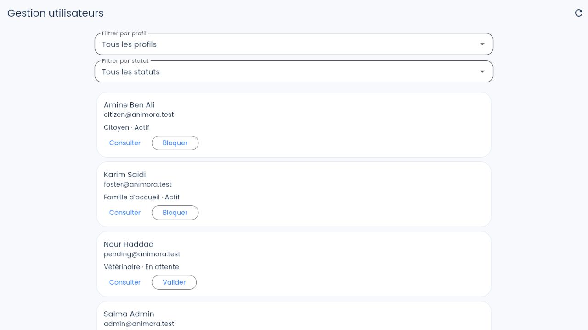

# Étape 2 — utilisateurs, authentification et accès
## Périmètre livré
L’architecture existante, le thème, Poppins, les cartes, l’accueil et la navigation
principale sont conservés. Aucune logique d’adoption, de dons, d’événements,
de garde ou de signalement n’a été développée.

### Inscription
Prénom, nom, e-mail, téléphone, ville, mot de passe, confirmation et profil
sont requis. Téléphone : 8 à 15 chiffres avec indicatif + facultatif ;
espaces, parenthèses, points et tirets sont acceptés.
Mot de passe : 8 caractères minimum. Confirmation exacte.
Email normalisé en minuscules après suppression des espaces externes.
L’unicité est vérifiée dans le repository, y compris pour les appels hors UI.
Les erreurs de saisie et l’email déjà utilisé sont affichés sous les champs.

Profils publics : citizen, veterinarian, fosterFamily, petSitter.
Pas d’Association ni d’entité User spécialisée. Admin ne peut être créé par
l’inscription publique, même en appelant directement le repository.
Citizen est actif ; les trois autres profils publics sont en attente.
Ces règles se trouvent dans AccountPolicy. L’inscription retourne à la connexion
avec confirmation et ne connecte pas automatiquement le compte.

### Session et accès
AuthSession est l’unique état de session partagé par provider.
GoRouter le surveille pour appliquer les redirections :
- Sans session : Login, avec accès à Register.
- Actif : Home et fonctionnalités générales.
- En attente : écran expliquant la validation nécessaire.
- Bloqué : écran de refus d’accès.
- Admin actif : /admin et /admin/users.
- Autres profils : accès direct aux routes /admin refusé.

Splash attend la restauration locale ; une erreur de lecture propose Réessayer
et ne remplace pas silencieusement les données existantes.
Les boutons sont désactivés durant les opérations.
Le logout efface l’identifiant de session sans effacer les comptes.
Les contrôles sont aussi appliqués aux mutations du repository.
Les comptes pending/blocked conservent leur identité uniquement pour leur écran
de statut, sans accès aux fonctionnalités normales.

### Profil et accueil
Avatar à initiales, nom, email, téléphone, ville, profil et statut en français.
Édition du prénom, nom, téléphone et ville ; retour au profil après sauvegarde.
Email, rôle et statut ne peuvent pas être modifiés depuis ce formulaire.
La salutation de l’accueil lit la session.
Les raccourcis généraux restent présents, avec un espace supplémentaire :
- Vétérinaire : Mon espace vétérinaire.
- Pet-sitter : Mes gardes.
- Famille d’accueil : Mes hébergements.
- Administrateur : Administration.

Les espaces professionnels sont encore des placeholders.
Leurs URLs sont réservées au profil correspondant et aux administrateurs.

### Administration
Liste des utilisateurs, filtres combinables profil/statut, détails du compte.
Actions proposées selon l’état : Valider, Bloquer, Réactiver.
Chaque mutation exige une confirmation nommant le compte et le nouveau statut.
La liste est rafraîchie après une mutation réussie.
L’administrateur connecté ne peut pas modifier son propre statut, pour éviter
de perdre son propre accès à l’administration.
Les écritures sont sérialisées ; si la sauvegarde échoue, l’état précédent est conservé.

## Dépendances ajoutées
- provider : ^6.1.5+1
- shared_preferences : ^2.5.6
- cryptography : ^2.9.0

go_router existant conservé. Aucun service externe ajouté.

## Parcours de test manuel
Mot de passe commun aux sept comptes fictifs : **Animora2026!**.
Les comptes et statuts initiaux sont listés dans README.md.

1. Lancer l’application ; sans session, Splash mène à Login.
2. Se connecter avec citizen@animora.test : vérifier l’accueil, les cinq onglets,
   puis Profil → Modifier le profil → Enregistrer. La salutation et le profil
   doivent refléter le nouveau prénom. Se déconnecter.
3. Essayer un mauvais mot de passe : message d’erreur sans ouverture de session.
   Vérifier le bouton afficher/masquer.
4. Ouvrir Register, soumettre vide, puis essayer un email invalide, un téléphone
   incorrect, un mot de passe court et une confirmation différente.
   Vérifier l’absence d’Administrateur dans les profils proposés.
5. Essayer citizen@animora.test à l’inscription : erreur sous l’email.
   Créer ensuite un citoyen avec un nouvel email fictif ; se connecter :
   le compte est actif. Créer un profil professionnel : sa connexion affiche
   l’attente de validation.
6. Tester pending@animora.test et blocked@animora.test : leurs écrans de statut
   interdisent l’accès à Home. Le bouton de retour ferme leur session.
7. Se connecter avec admin@animora.test. Accueil → Administration →
   Gestion utilisateurs. Filtrer Vétérinaire + En attente, consulter Nour,
   choisir Valider, annuler pour vérifier l’absence de changement,
   puis recommencer et confirmer.
8. Se déconnecter puis connecter pending@animora.test : Home est maintenant
   accessible. Revenir en administrateur et bloquer le citoyen ; sa connexion
   doit ensuite être refusée. Le réactiver en administrateur puis vérifier
   qu’il retrouve Home.
9. En citoyen actif, ouvrir directement /admin et /admin/users (sur Web :
   #/admin et #/admin/users) : l’écran Accès refusé doit apparaître.
10. Tester les trois comptes professionnels actifs : chacun dispose de son
    raccourci dédié. Les fonctionnalités générales restent accessibles.
11. Recharger l’application dans le même navigateur et à la même origine :
    la session doit être retrouvée. Se déconnecter puis revenir à une URL privée :
    Login doit réapparaître.

## Suite à prévoir après validation de cette étape
Repository REST, authentification/autorisation côté serveur, cycle de vie des tokens
et gestion d’image. SDK Android et environnement macOS/Xcode à prévoir pour la
validation sur appareils mobiles. Aucun module suivant n’est démarré.

