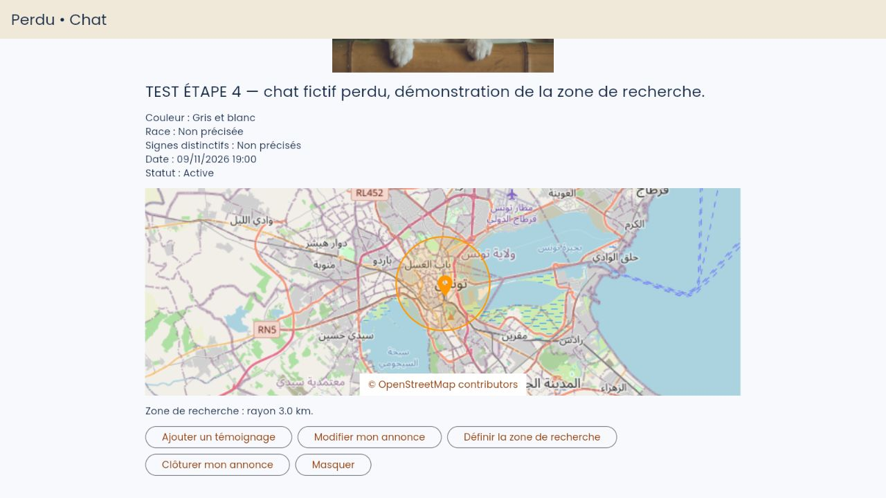

# Validation — Étape 4

Validation effectuée le 9 novembre 2026 sur Windows, Flutter 3.47.5 / Dart 3.13.4.

## Résultats

| Contrôle | Résultat |
| --- | --- |
| Base de l’étape 3B avant modifications | Analyse propre, 87 tests réussis |
| flutter pub get | Réussi |
| dart format . | Réussi |
| flutter analyze final | Aucun diagnostic |
| flutter test final | 118 tests réussis |
| flutter build web | Réussi ; premier build avec dry run Wasm réussi, dernier build JS avec --no-wasm-dry-run |
| Intégrité du logo | SHA-256 identique à la sauvegarde avant l’étape |

SHA-256 de `assets/images/animora_logo.png` :
`B5F45FACFFCC664D7BAD0A1552040ADB48C485F78F789D2A494528860A7D4A86`.

Les 87 tests préexistants restent inclus dans la suite complète. Les 31 nouveaux tests correspondent à 24 tests de règles / persistance / GPS et 7 tests d’interface.

## Couverture du nouveau module

- Création des signalements, identité imposée depuis la session, état initial NEW, date courante.
- Description, urgence, coordonnées incomplètes / hors limites / sans consentement.
- Position publique arrondie ; publication sans localisation après refus GPS.
- Interdiction de confirmer son propre signalement, des doublons et des confirmations après clôture.
- Modération ADMIN et transitions de statut, contenu rejeté invisible aux tiers.
- Création LOST et FOUND ; contrôle de l’auteur, type immuable, annonce clôturée non modifiable.
- Témoignages chronologiques, dates non futures, consentement.
- Zone LOST, propriété, rayon valide, conservation par identifiant d’annonce après sérialisation.
- Score borné, pondérations configurables, distance et exclusion des annonces masquées / clôturées.
- Recalcul sans doublon, rejet humain conservé, aucune validation automatique de propriété.
- Preuves privées au demandeur et ADMIN, réclamation sur FOUND d’un autre auteur, doublons empêchés.
- Impossibilité pour ADMIN de décider sa propre réclamation.
- Vérification atomique, rejet des concurrents, clôture LOST uniquement après correspondance confirmée humainement.
- Publication d’une histoire conditionnée à la vérification et clôture, publication unique.
- Persistance après recréation du repository, réouverture d’une base Sembast avec métadonnées et médias séparés, retour à l’état précédent en cas d’échec d’écriture.
- Comptes absents / bloqués / en attente refusés ; opérations et lecture différée de photo privée protégées lors d’un changement de compte.
- GPS désactivé, denied, deniedForever, panne et chemin autorisé à travers une passerelle injectée.
- Routes ADMIN, formulaires corrigibles et parcours réclamation → vérification → retrouvailles.
- Formulaires, cartes et détails testés à 360 px sans erreur Flutter ni overflow constaté.

## Contrôle Flutter Web réel

La version release a été servie sur `http://localhost:8765` et contrôlée dans le navigateur intégré.

1. Création d’un signalement explicitement fictif depuis le formulaire.
2. Saisie de coordonnées de démonstration, consentement et affichage d’OpenStreetMap.
3. Rechargement de la page : signalement conservé.
4. Publication d’une annonce LOST fictive, définition et sauvegarde d’un cercle de 3 km.
5. Import d’une copie de la photo locale de démonstration `assets/images/animals/cat.jpg` via le sélecteur, préparation PNG et enregistrement.
6. Rechargement du build final : annonce, photo et zone toujours présentes dans IndexedDB.
7. Carte chargée volontairement : fond OSM, marqueur, cercle, zoom et attribution visible / cliquable constatés.

Aucune position GPS réelle n’a été acquise. Deux publications marquées « TEST ÉTAPE 4 » restent dans le stockage de l’origine locale utilisée pour cette validation ; les données antérieures des autres modules ont été conservées.

## Plateformes natives

`flutter devices` expose Windows, Chrome et Edge, sans appareil Android / iOS. `flutter doctor -v` signale un SDK Android absent et des composants Visual Studio C++ manquants. iOS nécessite macOS / Xcode. Ces contraintes empêchent une validation d’exécution native ici ; aucune installation de SDK ou modification de sécurité du système n’a été effectuée.

Les permissions Android / iOS et le stockage natif sont configurés. La persistance Sembast et les erreurs GPS sont testées sans plateforme matérielle. Les dialogues réels de permission, la précision fournie par le téléphone et le cycle de vie natif doivent encore être testés sur appareil.

Les limites de stockage, de confidentialité locale et de partage sont détaillées dans [REPORTS_STEP_4.md](REPORTS_STEP_4.md), avec un scénario manuel complet.

