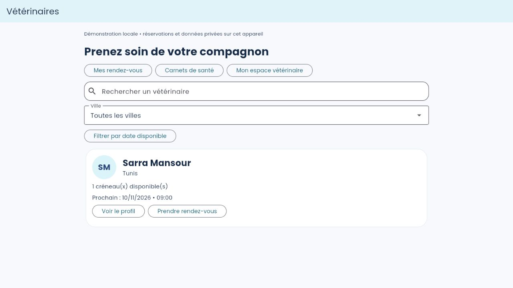
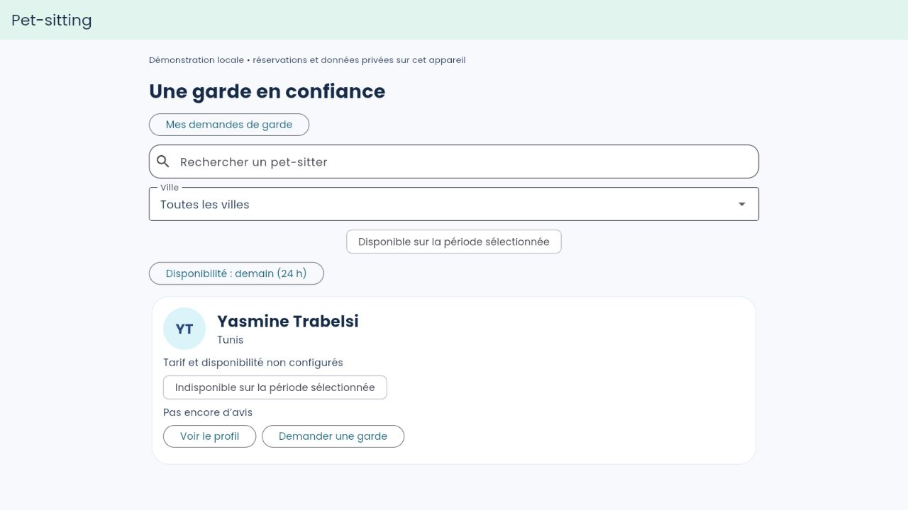

# Validation — Étape 5

## Résultats finaux

| Contrôle | Résultat |
| --- | --- |
| Base avant l’étape 5 | 118 tests réussis, analyse propre |
| flutter pub get | Réussi, aucune dépendance ajoutée |
| dart format . | Réussi |
| flutter analyze | Aucun diagnostic |
| flutter test | **162 tests réussis**, aucun test désactivé ou supprimé |
| flutter build web --no-wasm-dry-run | Réussi |
| User / Animal / logo / pubspec.yaml / pubspec.lock | Conservés à l’identique |

Les 44 nouveaux tests comprennent 31 tests des règles / persistance des services, 12 tests d’interface et un test de confidentialité de l’annuaire dans AuthRepository. Les 118 tests existants restent dans la suite ; les assertions qui attendaient les anciens espaces placeholders vérifient désormais les vrais tableaux de bord.

SHA-256 du logo officiel :
`B5F45FACFFCC664D7BAD0A1552040ADB48C485F78F789D2A494528860A7D4A86`.

## Diagnostic du blocage interrompu

Le traçage temporaire montrait qu’après une écriture, la lecture suivante était bien demandée, mais que la file asynchrone de l’annuaire attendait la boucle réelle pendant que le test tournait dans le temps simulé de `pumpAndSettle`.

Le test fait maintenant avancer les frames dans `tester.runAsync`, laisse terminer les futures réelles, puis appelle `pumpAndSettle`. La création, la modification et la suppression d’une disponibilité passent avec les mêmes assertions métier. Les traces temporaires ont été retirées du code.

Deux autres corrections de test ont été nécessaires : distinguer les boutons « Confirmer » des titres de dialogue et utiliser le bon animal de fixture (Luna, identifiant 1). Aucun contrôle d’accès, listener ou test n’a été supprimé pour masquer un échec.

## Couverture métier et sécurité

- Disponibilités : création, modification, suppression, dates / heures invalides, chevauchement, créneaux adjacents, identité imposée et droits professionnels.
- Rendez-vous : animal sous responsabilité, réservation atomique concurrente, créneau bloqué dès PENDING, refus, annulation, libération, acceptation et clôture contrôlées, notes privées.
- Santé : responsabilité issue d’une adoption signée ou d’un accueil réellement actif, patient du vétérinaire concerné, accès refusé aux tiers, vaccination / modification par l’auteur, soins et coût valide.
- Rappels : création automatique pour prochaine dose, remplacement / suppression à la modification du vaccin, rappel manuel autorisé et absence d’envoi fictif.
- Pet-sitting : configuration du bon profil actif, période et tarif valides, dates, interdiction de se réserver, animal autorisé, prix figé, arrondi exact de chaque tranche de 24 h entamée.
- Capacité : chevauchements refusés à l’acceptation, même animal protégé, demandes concurrentes revérifiées, une seule garde réellement IN_PROGRESS à la fois.
- Transitions : refus, annulation, démarrage, clôture ; demande expirée non démarrée encore annulable.
- Suivi : messages / médias uniquement pendant une garde commencée, consultation privée par participants / ADMIN, refus aux tiers et protection d’une lecture différée de photo lors d’un changement de compte.
- Avis : garde terminée, propriétaire concerné, note de 1 à 5 et un seul avis.
- Persistance : réouverture après redémarrage, données historiques, rollback sur écriture échouée et absence de réinitialisation silencieuse d’un snapshot corrompu.
- Annuaire : professionnels actifs uniquement, contacts privés retirés, liste administrative toujours protégée.
- Routes et UI : espaces professionnels réservés au profil attendu, navigation depuis l’accueil, parcours complet des rendez-vous / santé / gardes / avis et rendu à 360 px sans overflow constaté.

## Contrôle Web réel

L’application release a été servie sur `http://localhost:8765` et ouverte dans le navigateur intégré.

- Lancement et restauration de la session locale.
- Annuaire vétérinaire actif avec recherche, ville, profil et réservation.
- Connexion au compte vétérinaire fictif et création d’un créneau futur 10/11/2026, 09:00–10:00.
- Retour à la liste après écriture : le créneau apparaît libre, sans blocage applicatif.
- Rechargement du build final : le créneau est conservé dans IndexedDB.
- Annuaire pet-sitting : absence de tarif / disponibilité inventés lorsque le professionnel n’a pas configuré son service.
- Tentative d’ouverture de l’espace pet-sitter avec le compte vétérinaire : redirection vers Accès refusé ; le message explique maintenant la restriction de profil.
- La création de rendez-vous, la vaccination, le soin, les rappels, l’acceptation de garde, le suivi privé et les avis sont aussi couverts par les tests automatisés d’interface.

Le créneau de démonstration reste dans le stockage local utilisé pour ce contrôle. Les données préexistantes des autres étapes ont été conservées. Les comptes et animaux utilisés dans les tests sont fictifs.

## Limites de validation

`flutter devices` indique Windows, Chrome et Edge ; aucun appareil Android / iOS n’est connecté. Le lancement réel a été validé sur Web. Le cycle de vie, les performances et l’intégration natifs doivent encore être vérifiés sur appareil / environnement approprié.

Les données restent locales et non synchronisées. Le stockage n’est pas chiffré ; les autorisations applicatives ne remplacent pas une protection serveur. Aucun paiement, message distant, notification push ni certification officielle de professionnel n’est fourni.

Le [guide de l’étape 5](SERVICES_STEP_5.md) détaille le stockage, les règles de dates / responsabilité et le scénario manuel. La [liste des fichiers](FILES_5.md) distingue les créations et modifications. Le module Dons / étape 6 n’a pas été commencé.

